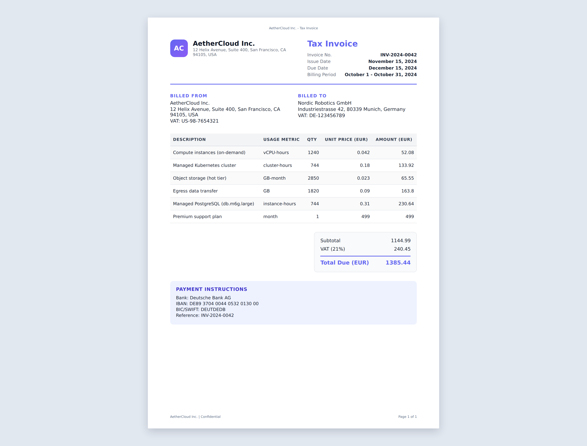
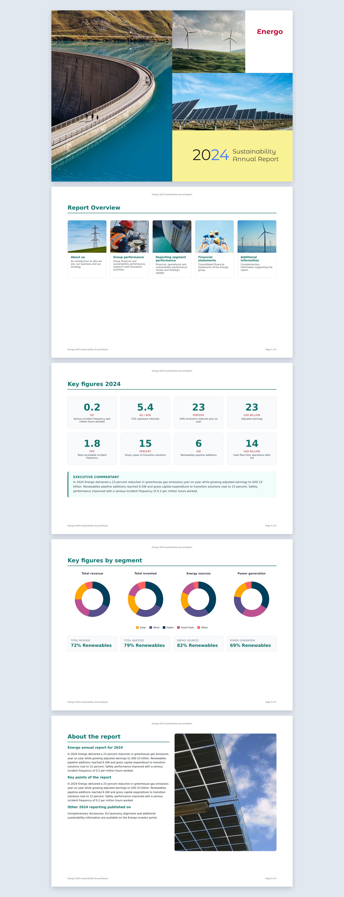
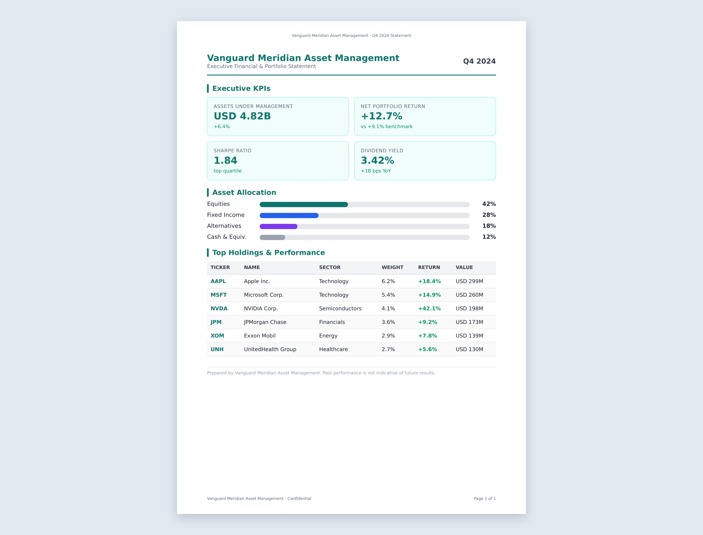
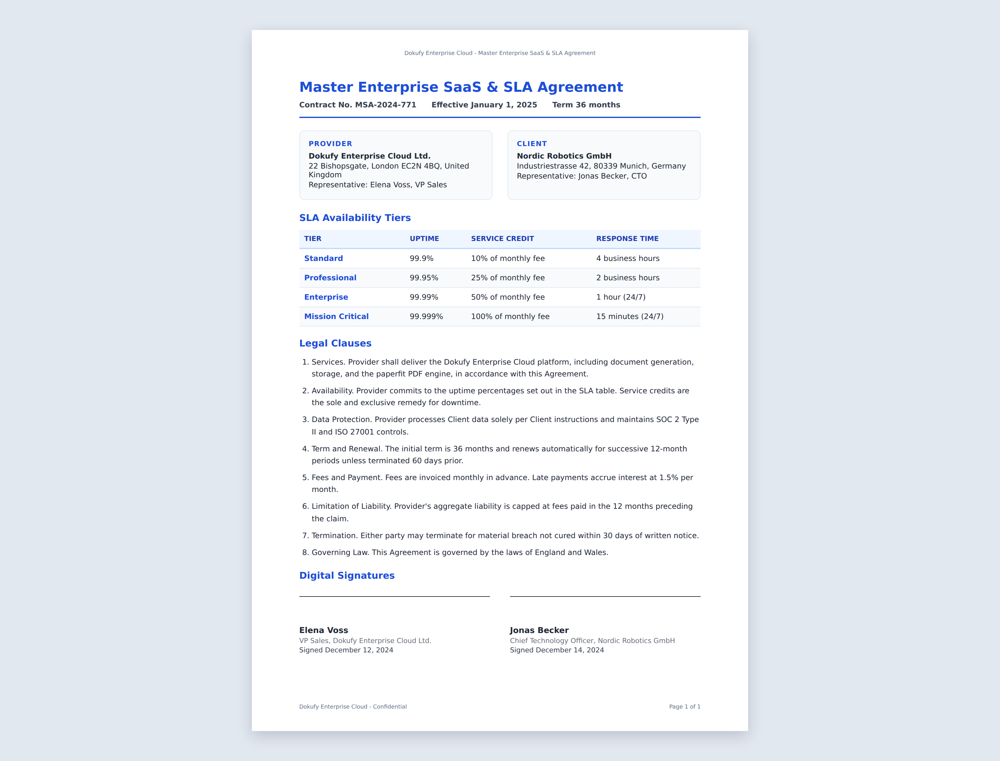

# pdf_examples

Reference PDF templates for the [paperfit](https://github.com/dokufy/paperfit) engine and [paperfitjs](https://github.com/dokufy/paperfitjs).

Each example is a short, self-contained template that runs in the browser, paginates with Paged.js, and is ready to upload to paperfit for PDF generation.

## Examples

- **vanilla-invoice**: Vanilla JS tax invoice (AetherCloud Inc. billing Nordic Robotics GmbH).
- **react-sustainability-report**: React + D3 sustainability annual report (Energo 2024, A4 landscape).
- **vue-financial-statement**: Vue 3 executive financial and portfolio statement (Vanguard Meridian).
- **angular-service-contract**: Angular master SaaS and SLA agreement (Dokufy Enterprise Cloud).

## Folder structure

```
pdf_examples/
  docs/previews/          preview screenshots
  examples/<name>/        template source (index.html, main.*, style.css, json_schema.json, variables.json)
  scripts/                build, preview, and test scripts
  dist/                   build output (generated)
```

## Build

```bash
npm install
npm run build
```

This builds all four examples into `dist/<example-name>/` and creates `dist/<example-name>.tar.gz` archives.

## Previews

```bash
npm run previews
```

Serves `dist/` and captures screenshots into `docs/previews/`.

## Test

```bash
npm test
```

Verifies build artifacts and that each example reaches `window.__PAPERFIT_READY__ === true` in headless Chromium.

## Send an example to paperfit

Upload an archive:

```bash
curl -X POST http://localhost:4000/pdf/from/archive/file \
  -F "file=@dist/vanilla-invoice.tar.gz" \
  -F "input=$(cat examples/vanilla-invoice/variables.json)"
```

Or render from HTML:

```bash
curl -X POST http://localhost:4000/pdf/from/html \
  -H "Content-Type: application/json" \
  -d '{"html":"<html>...</html>","options":{"waitForExpression":"window.__PAPERFIT_READY__ !== false"}}'
```

You can also use the paperfit MCP endpoint at `POST /mcp`.

## Visual examples

### Vanilla invoice



A modern cloud infrastructure tax invoice with line items, tax summary, and bank payment instructions.

### React sustainability report



A multi-page A4 landscape annual report with image cards, KPI figure boxes, and D3 donut charts.

### Vue financial statement



An executive financial and portfolio statement with KPI cards, asset allocation bars, and a holdings table.

### Angular service contract



A master SaaS and SLA agreement with parties, SLA tiers, legal clauses, and digital signature blocks.